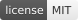
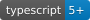

<!--  -->

# seo.gk

[](https://github.com/IkramMbz/seo-gk/blob/main/README.md#installation) [](https://github.com/glitchkids) [](https://github.com/IkramMbz/seo-gk/blob/main/LICENSE) [](https://nodejs.org/) [](https://www.typescriptlang.org/) [](https://reactjs.org/)

**seo.gk** by Glitch Kids, is a lightweight React library that provides real-time SEO auditing and optimization tools for your web applications. It automatically analyzes your pages and displays actionable insights to improve your search engine rankings.

Framework-agnostic, it works with any React-based setup (Astro, Next.js, Vite, etc.).
<!-- 🟠 -->
**Note:** seo.gk is currently in the testing phase and is not yet available on npm. It will be released soon.

## Table of Contents

- [Key Features](#key-features)
- [Installation](#installation)
- [Usage](#usage)
- [Contributing](#contributing)
- [License](#license)

## Key Features

- Real-time SEO audit with live feedback (development mode only)
- Framework-agnostic: works with any React setup
- Comprehensive checks covering 50+ SEO best practices
- Performance hints (critical resources, resource hints)
- Mobile-friendly and accessibility checks

## Installation

To use seo.gk in your project, your environment must meet the following minimum requirements:

- **Node.js** ≥ 18 (for full ESM support and modern module resolution)
- **Package Manager:** `pnpm` ≥ 7 (or `npm` / `yarn`, scripts are tested with pnpm)

Initialize your project if you haven't already:

```bash
npm init -y
```

Then install the library directly from GitHub (since it's not yet published on npm):

```bash
npm install https://github.com/IkramMbz/seo.gk
```

## Usage

### Basic Setup

Import the SEO checker component into your React project:

```tsx
import SEOChecker from "seo-gk";

export default function App() {
    return (
        <body>
            <SEOChecker />

            <main class="main-content etc.">
                <h1>My SEO-friendly page</h1>
                {/* Your app content */}
            </main>
        </body>
    );
}
```

The `SEOChecker` component will automatically appear in development mode, displaying a floating widget with your SEO score and detailed audit results. It is **not** dev-only by default — you must wrap it in a dev-mode check yourself, otherwise it will be visible in production. The check depends on your build tool:

```tsx
// Vite (and Vite-based tools like Astro's React integration)
{
    import.meta.env.DEV && <SEOChecker />;
}

// Next.js
{
    process.env.NODE_ENV !== "production" && <SEOChecker />;
}

// React Apps / Webpack-based setups
{
    process.env.NODE_ENV !== "production" && <SEOChecker />;
}

// etc.
```

> See [README_DEV.md](./README_DEV.md) for a full local testing setup using Vite.

## Contributing

Components and features are actively developed and may change. Community contributions will be welcomed in the future.

## License

seo.gk is licensed under the [MIT License](./LICENSE).
